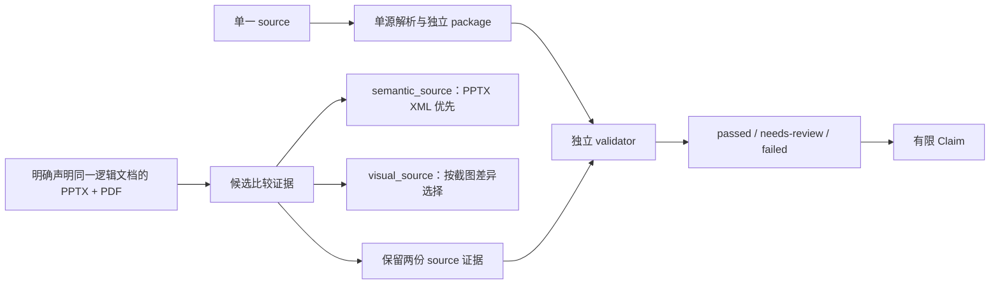
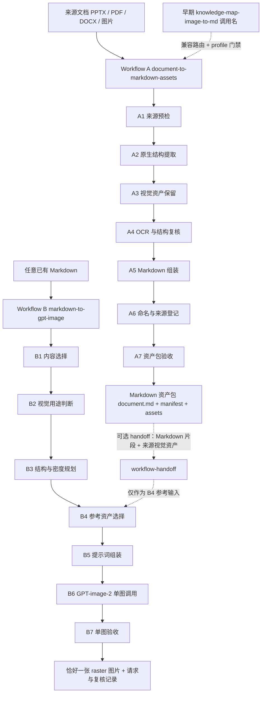
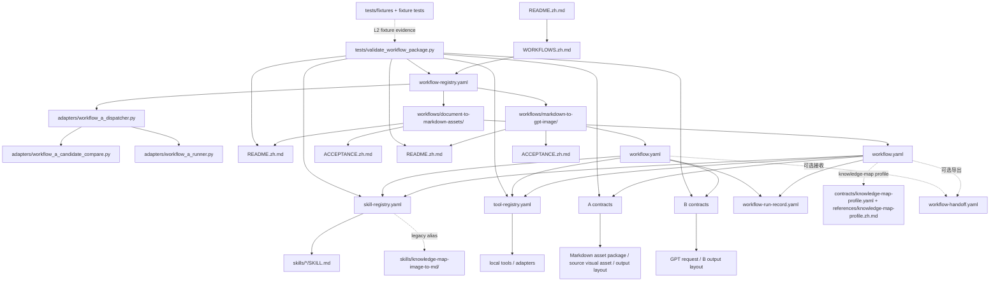

# Workflow 链路与文件关系图

这份文件是工程 Chain 的人工可读入口。它不替代 `workflow.yaml`，而是把已确认的需求任务映射到 Spec、工程 Task、Workflow、Skill/Tool、Run、Evidence、Verdict 和 Claim。

[`TASK-TREE.zh.md`](TASK-TREE.zh.md) 只负责需求描述和需求任务分解，不再承担 Chain、Workflow 或证据结构。本文件只消费已确认的需求段落和任务组，不能反向改写需求。只有本文件的工程映射再被人工确认后，才投影到 `workflow.yaml`、contracts、registry 和 adapters。

阅读顺序建议是：先用根 `README.md` 确定入口，再看 `TASK-TREE.zh.md` 明确需求与验收，再用 `WORKFLOWS.zh.md` 选择 Workflow；需要理解链路时看本图，实际执行 Workflow A 时进入其 `README.zh.md` 和 `WORKFLOW-A-EXECUTION.zh.md`。本图中的箭头是关系说明，不是机器执行顺序的第二份配置。

## 0. 从需求任务到工程 Chain


这里存在两类 Task，不能混用：

- **需求任务**：位于 `TASK-TREE.zh.md`，回答“用户要求我们解决什么”，例如来源独立、候选边界、证据分层。
- **工程 Task**：位于本工程 Chain 的映射中，回答“为满足已确认需求，需要实现和验证什么”，确认后才进入工程计划和测试。

`A1 来源预检` 的读者语言是“确认来源能不能读、该用哪份”；它要解决来源不可读、候选误配和 PPTX/PDF 选择错误。阶段字段是需求任务的工程映射，不是需求任务树本身。

## 0.1 来源与结论边界



这里的“候选比较证据”不是第三种业务来源，也不是自动合并器。没有明确候选声明时，PPTX 和 PDF 必须分别进入单源路径；即使声明了候选，比较报告也不能替代任一来源 package。所有语义字段必须回指当前 source 的原生提取、当前 OCR/视觉证据或 `Unknown`。

## 0.2 文件职责闭合

| 层级 | 人工阅读入口 | 工程映射（确认后） | 通过条件 | 当前状态 |
|---|---|---|---|---|
| 背景/目标 | `GOAL.zh.md` | 暂不投影 | 用户问题、范围、非目标清楚 | ready-for-confirmation |
| 需求任务 | `TASK-TREE.zh.md` | 暂不投影 | 需求组之间有清楚的先后、交付和验收问题 | ready-for-confirmation |
| Chain | 本文件第 0、0.1 节 | `contracts/requirement-chain.yaml` | 需求任务到 Spec/Workflow 的依赖、数据流、停止点明确 | needs-review |
| Spec | 本文件第 1.1、3 节 | `workflow.yaml`、`contracts/*.yaml` | 单源、候选、证据、状态、布局规则可检查 | pending-task-tree-confirmation |
| 工程 Task | 本文件第 0.3 节 | 后续工程计划与测试矩阵 | 每项能回指需求任务和 Spec | pending-task-tree-confirmation |
| Workflow | 本文件第 1 节 | `workflow-registry.yaml`、`workflows/*` | 阶段、输出、失败态、验收入口互相引用 | pending-task-tree-confirmation |
| Skill/Tool | 本文件第 2、3 节 | `skill-registry.yaml`、`tool-registry.yaml`、`skills/*` | 引用可定位，planned 不冒充可用 | pending-task-tree-confirmation |
| 已知错误目录 | 本文件第 0.4 节 | `references/known-failures.zh.md` | 规格风险、夹具边界和真实 Run 观察分层；不把错误目录当成业务证据 | needs-review |

这张表不证明任何解析器、OCR、候选比较器或真实运行已经通过。当前只允许确认 `GOAL + TASK-TREE`；Chain 及其后续工程映射仍需在需求任务树确认后复核。

## 0.3 需求任务到工程 Task 的映射草案

| 已确认的需求组 | 工程 Task 草案 | 预期 Spec | 停止条件 |
|---|---|---|---|
| 获得与当前源文件对应的 Markdown | 建立单源 Markdown 转换和内容映射 | native content、output layout | 当前源文件无法形成可对应内容即 blocked |
| 保留源文件中有意义的内容和关系 | 分离文本、结构、页面图、区域图和嵌入媒体 | native content、asset manifest | 内容或视觉证据缺失、断链即 needs-review |
| 让复杂图文内容仍然可以理解和修正 | 建立复杂区域识别、差异记录和局部修复能力 | reconciliation、stage evidence | 关系无法说明且没有保留依据即 needs-review |
| 避免把不同材料混成一份内容 | 建立单源/显式候选输入门禁和来源边界 | source inventory、candidate comparison | 来源关系不明不得合并 |
| 如实表达结果的边界 | 独立 validator 重读并分层输出状态和 Claim | acceptance、failure report | 无 validator 或有未决 P0 不得 passed |
| 分离读者标题与来源追溯元数据 | A5 reader layer 与 A6 manifest 分层；标题前缀回归检查 | output layout、manifest、known failures K-001 | 语义标题被源文件名/页码污染即 needs-review，不得把元数据混入正文 |
| 使用可验证的局域网视觉资源并安全降级 | A4 记录局域网模型调用；失败时 Apple Vision OCR，再到 needs-review | mac96-visual-review、local-ocr、reconciliation、known failures K-005/K-006 | 无连通性/模型/响应证据不得声称视觉复核完成 |

该表是工程映射草案，不是已批准实现计划。

## 0.4 需求回写的两个新增门禁

本轮从已有 Workflow/Skill/验收规则反向提炼出两项必须回到需求层的门禁：

1. **读者标题与来源追溯分层**：A5 只负责读者可读的语义；源文件名、页码、哈希、对象 ID 和 occurrence 由 A6/manifest/evidence 保存。只有没有可确认标题时，才允许用页码作为临时标题，并进入 `needs-review`。对应长期错误为 [`references/known-failures.zh.md`](references/known-failures.zh.md) 的 K-001。
2. **局域网视觉资源必须可验证**：A4 可以优先调用局域网视觉模型，当前登记的 `mac96` 与 SSH 只是一个可替换资源/transport 组合；每次 Run 必须记录连通性、目标、模型、输入输出和失败状态。不可用时按 Apple Vision OCR，再到 `needs-review` 降级；在线视觉模型默认不调用。对应 K-005/K-006。

这两项是需求门禁到工程门禁的映射，不是对任何真实 Run 的通过结论。

## 1. 总体业务链路



关键边界：

- A 可以独立运行，不调用 GPT-image-2；
- B 可以消费任意 Markdown，不要求一定来自 A；
- 已有转换结果的人工可读性审计继续由原工作流的后续阶段、步骤技能和续接提示词承载，不另立 Workflow；
- A 的视觉资产默认是来源证据/参考输入，不自动变成模板；
- B 的主产物是一张图片，不是 PPTX、PDF 或图片批次。

## 1.1 Workflow A 的执行门禁

| 顺序 | 用户要确认什么 | 最小证据 | 未通过时 |
|---|---|---|---|
| 1. 单页 | 当前 source 的文字、页面图和链接是否互相对应 | 原生文本/布局、页面图、来源指纹、Markdown 片段 | 停在 `needs-review` 或 `failed` |
| 2. 两页 | 页序、相邻页边界和 checkpoint 是否连续 | 两页独立资产、页码映射、运行记录 | 不进入候选比较 |
| 3. 候选比较 | PPTX/PDF 是否被明确声明为同一逻辑文档，差异是否可解释 | 代表页截图、差异指标、五项选择字段 | 保持独立 package，或 `needs-review` |
| 4. 排版异常 | PPTX 错位/遮挡/不可见时，是否切换主视觉证据 | XML、PPTX 渲染、PDF 页面图、错误诊断 | 不得声称 PPTX 视觉可信 |
| 5. 全量 | 前四个门禁已通过且可恢复 | 全量 run-record、独立 validator 报告 | 不运行或标记 `failed` |

## 2. 文件关系图



## 3. 文件职责对照

| 层级 | 文件/目录 | 负责什么 | 不负责什么 |
|---|---|---|---|
| 根入口 | `README.zh.md` | 包级导航和边界 | 不重复阶段细节 |
| 已知错误参考 | `references/known-failures.zh.md` | 长期错误模式、检测证据、期望处理和状态边界 | 不记录某一次 Run 的事实，不替代 failure report |
| 总览 | `WORKFLOWS.zh.md` | A/B 选择和关系 | 不执行 Workflow |
| 关系图 | `WORKFLOW-MAP.zh.md` | 文件、链路和证据关系 | 不作为机器路由配置 |
| 注册 | `workflow-registry.yaml` | 机器可读 Workflow 入口 | 不描述每个 Skill 的过程 |
| 执行规格 | `workflows/*/workflow.yaml` | 阶段、Skill、Tool、失败态、证据 | 不替代人类说明 |
| 人类说明 | `workflows/*/README.zh.md` | 输入、输出、运行方式、成本 | 不作为机器路由配置 |
| 验收 | `workflows/*/ACCEPTANCE.zh.md` | 质量门禁 | 不记录运行日志 |
| 能力 | `skills/*/SKILL.md` | 可复用判断与操作指导 | 不决定全局阶段顺序 |
| 兼容入口 | `skills/knowledge-map-image-to-md/` | 保留旧调用名并加载知识地图差异策略 | 不复制 A1-A7，不成为新阶段 |
| 历史归档 | `archive/legacy-skills/knowledge-map-image-to-md/` | 保存原始技能、快照哈希和迁移说明 | 不参与路由，不作为当前 Skill |
| 执行组件 | `tool-registry.yaml` | 解析器、OCR、渲染器、模型适配器登记 | 不承诺 `planned` 已实现 |
| A bounded 入口 | `adapters/workflow_a_dispatcher.py` | 读取 registry/workflow、拒绝 `--pages all`、记录 A1-A7 envelope、调用候选比较和 runner | 不实现解析、OCR 或 Markdown 组装，不是第二套 Workflow |
| 候选比较 | `adapters/workflow_a_candidate_compare.py` | 在明确声明同一逻辑文档时比较 PPTX/PDF 候选并记录 `semantic_source`、`visual_source`、`visual_difference`、`selection_reason`、`uncertainties` 和差异证据 | 不把两个来源合并成一个 package，不替代单一来源转换 |
| A 兼容执行器 | `adapters/workflow_a_runner.py` | 对一个 `source` 执行解析、渲染、复核/兜底、Markdown/manifest/report 生成并调用独立 validator | 不替代 bounded dispatcher，不以自报状态取代独立验收 |
| A 多文件编排器 | `adapters/workflow_a_batch.py` | 按 source 建立可恢复队列、串行优先/受控并发、重试和批次 run-record；每个 source 调用单文件 runner | 不合并来源，不把批次状态冒充单包验收 |
| 数据契约 | `contracts/*.yaml` | 输入、输出、handoff、运行记录、目录结构 | 不保存真实业务产物 |
| 证据 | `tests/`、`tests/runs/` | fixture、验证结果和运行记录 | 不替代正式 `output_root` |

## 4. 当前遗漏环节与处理状态

状态只表示规格或证据所处阶段，不等同于 runner 自报完成。只有独立 validator 的结果才能授权 `passed`。

| 环节 | 影响 | 当前处理 | 状态 |
|---|---|---|---|
| A→B 交接边界 | 不清楚 A 的哪些资产可以给 B | 新增 `workflow-handoff.yaml` | 规格已补齐 |
| Workflow B 正式输出目录 | 只有 README 示例，缺少机器可校验布局 | 新增 `workflow-b-output-layout.yaml` | 规格已补齐 |
| 运行 ID、输入指纹、版本快照 | 无法稳定恢复、去重和审计 | 新增 `workflow-run-record.yaml` | 规格已补齐 |
| 早期知识地图技能与 Workflow A 重复 | 入口漂移、两套 OCR/Markdown 规则可能分叉 | 兼容入口 + `knowledge-map-profile.zh.md` + profile contract | 规格已收敛；实现仍由独立测试确认 |
| 失败后恢复/重试 | 容易重复调用或丢失中间产物 | 批次 `run-record.yaml`、source digest、attempt 目录和 `--resume` | 规格已登记；真实长时运行仍需观测 |
| 隐私/授权/保留策略 | 来源图片可能被不当外发或长期保留 | 增加运行记录和 handoff 的禁止秘密字段、保留边界 | 规格已补齐，策略实现待做 |
| 人工复核入口 | 复杂关系和图片文字不能完全自动判断 | A4/B7 明确 `needs-review` 和复核报告 | 规格已补齐 |
| 在线额度/实际用量 | 无法解释 GPT-image-2 消耗 | B 请求契约和运行记录保存调用次数/额度摘要 | 规格已补齐，供应商计费待做 |
| 真实本地工具 E2E | 静态通过不等于解析器完成 | 当前明确证据等级 L1/L2/L3/L4 | 实现阶段待做 |

## 5. 不能遗漏的实现顺序

```text
先实现运行记录与输出目录
  → 再实现 PPTX/PDF/DOCX 原生提取
  → 再实现页面渲染、媒体提取、裁剪和 OCR
  → 再实现 Markdown/manifest 组装与验收
  → 再实现 A→B handoff
  → 最后接入 mac96 和 GPT-image-2 在线适配器
```

原因：如果没有运行记录、输出布局和来源追溯，后面即使解析或生成成功，也无法稳定判断产物是否完整、是否重复、是否可复现。
