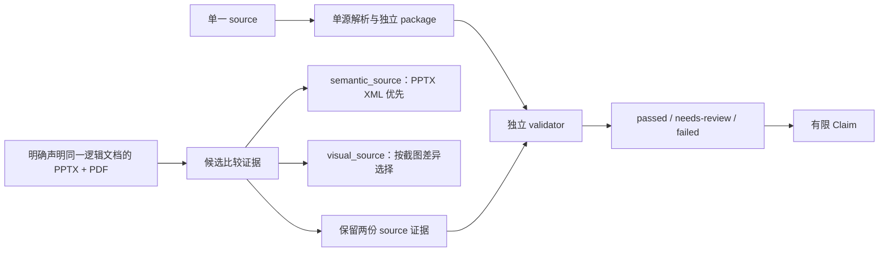
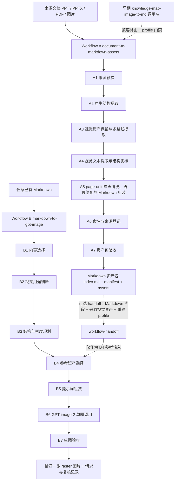
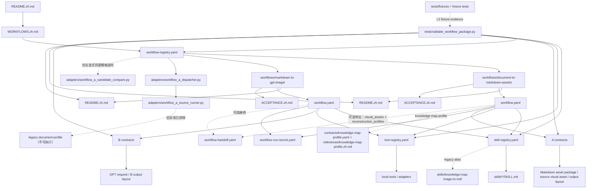

# Workflow 链路与文件关系图

这份文件是工程 Chain 的人工可读入口。它不替代 `workflow.yaml`，而是把已确认的需求任务映射到 Spec、工程 Task、执行任务树、Workflow、Skill/Tool、Run、Evidence、Verdict 和 Claim。

[`TASK-TREE.zh.md`](TASK-TREE.zh.md) 只负责需求描述和需求任务分解，不再承担 Chain、Workflow 或证据结构。工程 Task 的可执行纵向切片另见 [`EXECUTION-TASK-TREE.zh.md`](EXECUTION-TASK-TREE.zh.md)。本文件只消费已确认的需求段落和任务组，不能反向改写需求。只有本文件的工程映射再被人工确认后，才投影到 `workflow.yaml`、contracts、registry 和 adapters。

阅读顺序建议是：先用根 `README.md` 确定入口，再看 `TASK-TREE.zh.md` 明确需求与验收，再用 `WORKFLOWS.zh.md` 选择 Workflow；需要理解链路时看本图，实际执行 Workflow A 时进入其 `README.zh.md` 和 `WORKFLOW-A-EXECUTION.zh.md`。本图中的箭头是关系说明，不是机器执行顺序的第二份配置。

## 0. 从需求任务到工程 Chain


这里存在两类 Task，不能混用：

- **需求任务**：位于 `TASK-TREE.zh.md`，回答“用户要求我们解决什么”，例如来源独立、候选边界、证据分层。
- **工程 Task**：位于本工程 Chain 的映射中，回答“为满足已确认需求，需要实现和验证什么”，确认后才进入工程计划和测试。

`EXECUTION-TASK-TREE.zh.md` 是工程 Task 的展开，不是参考链路中新增的第 11 个节点。它定义 ET0–ET5 的依赖、单页纵向切片、单文件多页、多文件编排和测试/质量门；Workflow 仍负责一次运行的阶段顺序。

`A1 来源预检` 的读者语言是“确认来源能不能读、该用哪份”；它要解决来源不可读、候选误配和 PPTX/PDF 选择错误。阶段字段是需求任务的工程映射，不是需求任务树本身。

## 0.1 来源与结论边界



这里的“候选比较证据”不是第三种业务来源，也不是自动合并器。没有明确候选声明时，PPTX 和 PDF 必须分别进入单源路径；即使声明了候选，比较报告也不能替代任一来源 package。所有语义字段必须回指当前 source 的原生提取、当前 OCR/视觉证据或 `Unknown`。

## 0.2 文件职责闭合

| 层级 | 人工阅读入口 | 工程映射（确认后） | 通过条件 | 当前状态 |
|---|---|---|---|---|
| 背景/目标 | `GOAL.zh.md` | 暂不投影 | 用户问题、范围、非目标清楚 | ready-for-confirmation |
| 需求任务 | `TASK-TREE.zh.md` | 暂不投影 | 需求组之间有清楚的先后、交付和验收问题 | ready-for-confirmation |
| Chain | 本文件第 0、0.1 节 | `contracts/requirement-chain.yaml` | 需求任务到 Spec/Workflow 的依赖、数据流、停止点明确 | needs-review |
| Spec | 本文件第 1.1、3 节 | `workflow.yaml`、`contracts/*.yaml` | 单源、候选、证据、状态、布局规则可检查 | pending-task-tree-confirmation |
| 工程 Task | 本文件第 0.3 节 + `EXECUTION-TASK-TREE.zh.md` | 后续工程计划与测试矩阵 | 每项能回指需求任务和 Spec；单页纵向切片先于规模扩展 | pending-task-tree-confirmation |
| Workflow | 本文件第 1 节 | `workflow-registry.yaml`、`workflows/*` | 阶段、输出、失败态、验收入口互相引用 | pending-task-tree-confirmation |
| Skill/Tool | 本文件第 2、3 节 | `skill-registry.yaml`、`tool-registry.yaml`、`skills/*` | 引用可定位，planned 不冒充可用 | pending-task-tree-confirmation |
| 已知错误目录 | 本文件第 0.4 节 | `references/known-failures.zh.md` | 规格风险、夹具边界和真实 Run 观察分层；不把错误目录当成业务证据 | needs-review |

这张表不证明任何解析器、OCR、候选比较器或真实运行已经通过。当前只允许确认 `GOAL + TASK-TREE`；Chain 及其后续工程映射仍需在需求任务树确认后复核。

## 0.3 需求任务到工程 Task 的映射草案

| 已确认的需求组 | 工程 Task 草案 | 预期 Spec | 停止条件 |
|---|---|---|---|
| 获得与当前源文件对应的 Markdown | 建立单源 Markdown 转换和内容映射 | native content、output layout | 当前源文件无法形成可对应内容即 blocked |
| 保留源文件中有意义的内容和关系 | 分离文本、结构、页面图、区域图和嵌入媒体 | native content、asset manifest | 内容或视觉证据缺失、断链即 needs-review |
| 图片资产多格式提取与先成功再降本（可选） | A3/ET1.4：按需为 PPT/PPTX、PDF、独立图片选择无损提取、页面渲染和裁剪；启用时先用授权高质量在线模型建立基准，再用同输入本地模型校准，达标后才走低成本路线 | `references/asset-extraction-strategy.zh.md`、`contracts/asset-extraction-strategy.yaml`、`asset-quality-comparison` | 启用后缺少同输入比较、质量/追溯门或独立审计时，不得声称本地等价或已降本；该可选工作包不阻塞 ET2 多页扩展 |
| 为图片模型重建保存关键结构/提示词（启用复杂资产时可选） | A4/ET1.4：对启用的复杂结构或明确重建意图的资产生成结构版 + 提示词版 profile，逐字段回指原图/区域/文字证据 | `references/visual-reconstruction-profile.zh.md`、`contracts/visual-reconstruction-profile.yaml`、`evidence/visual-reconstruction-profile.yaml` | 启用后 profile 缺字段、缺来源 span 或存在未决关系时，只能 `needs-review`；未启用不阻塞 ET2 |
| 让复杂图文内容仍然可以理解和修正 | 建立复杂区域识别、差异记录和局部修复能力 | reconciliation、stage evidence | 关系无法说明且没有保留依据即 needs-review |
| 避免把不同材料混成一份内容 | 建立单源/显式候选输入门禁和来源边界 | source inventory、candidate comparison | 来源关系不明不得合并 |
| 如实表达结果的边界 | 独立 validator 重读并分层输出状态和 Claim | acceptance、failure report | 无 validator 或有未决 P0 不得 passed |
| 分离读者标题与来源追溯元数据 | A5 reader layer 与 A6 manifest 分层；标题前缀回归检查 | output layout、manifest、known failures K-001 | 语义标题被源文件名/页码污染即 needs-review，不得把元数据混入正文 |
| 知识库导入前可选剔除整页低价值内容 | ET5.4：完整 page-units 汇合后，对知识库工作副本生成哈希锁定预览；只删除已批准的目录、版权、推广等整页候选，并从保留页重建下游索引/合并全文 | `contracts/ebook-page-pruning.yaml`、`skills/prune-low-value-ebook-pages/SKILL.md`、`ebook-page-pruning.json` | 页面未完整汇合、页码/理由不明确、目录快照漂移或下游文件未重建时停止；不得把清洗状态升级为 Workflow A 通过 |
| 使用可验证的局域网视觉资源并安全降级 | A4 由 `vision-page-analysis` 默认以 `full + single` 一次输出 Markdown 与视觉结构；高风险页面显式使用 `dual`；当前对话视觉模型或 Apple Vision OCR 只能补文字层，不能伪造视觉关系 | `vision-page-analysis`、`local-ocr`、`reconciliation`、known failures K-005/K-006 | 无连通性/模型/结构化响应证据不得声称视觉理解完成 |
| 单页技术可行性纵向切片 | ET1：从当前 source 贯穿内容提取、页面视觉证据、Markdown、命名、审计到独立验收；图片资产按需启用 | `EXECUTION-TASK-TREE.zh.md`、quality targets、A1–A7 | 不能只凭某个 Skill 或 runner `complete` 进入多页/多文件 |
| 单文件多页面扩展 | ET2：页码选择、smoke、checkpoint、恢复和跨页隔离 | `workflow-a-batch.yaml`、run record、page-batch evidence | smoke、checkpoint 或邻页边界失败即停止扩展 |
| 多文件编排 | ET3：精确去重、单源独立 package、保守并发和逐包验收 | `workflow-a-batch.yaml`、batch `run-record.yaml` | 批次总状态不得掩盖任一 source 的失败或 needs-review |
| 修复审计与 95+ 质量门 | ET1.2/ET1.5 + ET4.5：语言修复、问题清单、局部修复、复验和独立评分 | `references/markdown-quality-audit.zh.md`、`quality-targets.zh.md`、A7 | 没有当前 source 的扣分证据、re-audit 或恢复证据不得声称 95+ |
| 文字质量优化 | ET1.2：页面单元生成后的局域网优先语言修复；在线模型只作明确授权的失败后回退；页面修复只执行内联结构守卫，不另起测试阶段 | `evidence/markdown-content-repair-pNNN.json`、`reviews/markdown-content-repair.yaml`、K-011 | 没有输入/输出哈希、逐项差异、来源边界和结构守卫记录不得声称文字已优化 |
| 长时运行可观察性 | ET0.2–ET0.4：独立 smoke、心跳、硬停止、checkpoint 和遗漏差集 | `evidence/progress.jsonl`、`smoke-report.json`、K-012 | 没有逐页进度或 smoke Verdict 不得进入后续页 |

该表是工程映射草案，不是已批准实现计划。

### 0.3.1 脚本执行门禁与遗留边界

工程执行不是“把目录中的脚本依次都跑一遍”。每个脚本必须声明前置证据；前置阶段没有明确终态时，调度器停止并保留当前证据。允许的 fallback 也必须是当前 Workflow 明确登记的下一路径，不能因为主路径失败就任意启动其他脚本。

脚本状态、历史规则和排除边界见 [`references/legacy-code-status.zh.md`](references/legacy-code-status.zh.md)。旧恢复脚本已删除，不能用来绕过来源预检、smoke 或独立验收。

### 0.3.2 工程执行任务树的定位

用户提出的“单页转换、图片命名、原生/OCR/视觉提取、Markdown 修复、AI 审计、多页、多文件、测试”不应继续散落在 `GOAL`、需求 `TASK-TREE` 或某个 Skill 的说明里。它们统一进入 [`EXECUTION-TASK-TREE.zh.md`](EXECUTION-TASK-TREE.zh.md)，作为工程 Task 的纵向展开。

该树当前把 ET0 定义为执行控制与可观测基线，把 ET1 定义为单页内容质量纵向切片，把 ET2/ET3 定义为规模扩展，把 ET4 定义为测试与质量门，并把知识库低价值页清洗定义为 ET5.4 可选下游任务。它同时记录对现有 A1–A7/Skill 拆分的复盘：A4 的能力可用性、候选生成和裁决需要分开；A5 在原生/OCR/视觉投影后先执行确定性页眉页脚清洗，再执行独立语言质量修复；A5/A6 必须先有稳定资产 ID 再闭合最终链接；A7 的 package validator 不能冒充语义/视觉质量审计；ET5.4 不能反向删除或改变 Workflow A 的来源证据。现有目录仍是实现投影和历史运行证据，不能反向证明这棵树已经通过。

## 0.4 需求回写的页面独立单元与视觉门禁

本轮从已有 Workflow/Skill/验收规则反向提炼出以下必须回到需求层的门禁：

1. **读者标题与来源追溯分层**：A5 只负责读者可读的语义；源文件名、页码、哈希、对象 ID 和 occurrence 由 A6/manifest/evidence 保存。只有没有可确认标题时，才允许用页码作为临时标题，并进入 `needs-review`。对应长期错误为 [`references/known-failures.zh.md`](references/known-failures.zh.md) 的 K-001。
2. **识别候选资源必须可验证**：A4 不预设 Apple Vision OCR、mac96 小视觉模型或 mac96 30B 的主次；当前登记的 `mac96` 与 SSH 只是一个可替换资源/transport 组合。每次 Run 必须记录目标、模型、提示词版本、输入输出、结构质量、耗时、资源和失败状态；当前对话或外部在线 provider 仍需用户显式授权，结果都只能是 candidate；传输失败不自动进入 `needs-review`。对应 K-005/K-006。

3. **启用图片资产提取时必须单独校准**：A3/ET1.4 按需先用确定性方法分别保留 PPT/PPTX、PDF 和独立图片的原始/页面/区域资产；得到授权时再用高质量在线视觉模型建立基准，用同一输入、schema、提示词版本和评分表让本地视觉模型复现。只有质量、重复性、成本和来源追溯证据同时通过，才允许切换本地默认路线；否则该可选工作包保留 `needs-review` 或使用明确授权的便宜在线 fallback，不阻塞 ET2。对应 [`references/asset-extraction-strategy.zh.md`](references/asset-extraction-strategy.zh.md)。

4. **启用复杂视觉资产时必须保存重建输入**：A4/ET1.4 对启用的流程图、矩阵、关系图、复杂图文混排或明确需要再次生成的资产，保存 `visual-reconstruction-profile` 的画布、区域、元素、层级、关系、文字、样式、可复用 prompt、负向约束和来源证据；无法确认的字段保留 `Unknown`/`needs-review`。未启用该可选资产路线不阻塞 ET2。Workflow B 只能把它作为结构/提示词参考，不能据此声称生成图片与来源像素等价。对应 [`references/visual-reconstruction-profile.zh.md`](references/visual-reconstruction-profile.zh.md)。

5. **视觉资产物理目录保持扁平**：正式 Workflow A 包统一使用 `assets/`，页面图、嵌入媒体和按需区域图
   直接落在该目录；资产类型由 manifest 的 `asset_kind`、来源位置和 occurrence 区分，不再预创建
   `pages/`、`regions/`、`embedded/` 子目录。`markdown-asset-copy` 只复制 Markdown 实际引用的图片，
   并继续输出到读者层 `assets/`。文件名只使用最短英文语义名，页码进入 manifest/evidence，来源哈希、
   `page-render`、`original-page`、`o01` 等字段只进 manifest/evidence。对应
   [`references/naming-policy.zh.md`](references/naming-policy.zh.md) 和
   [`skills/markdown-asset-copy/SKILL.md`](skills/markdown-asset-copy/SKILL.md)。

6. **页面修复采用严格阶段门**：第 1 页是唯一首个处理单元；第 1 页页面结构守卫未通过时，不得处理
   第 2–total_pages 页。第 1 页通过后只开放第 2–5 页小批量，且必须经过人工查看；只有第 2–5 页通过后
   才能进入第 6-total_pages 页。页面单元只能读取当前页 Markdown 和当前页图，原始 OCR/Vision/bbox/
   置信度/manifest 保持只读；合并按固定页序确定性进行，`document-temp.md` 只是派生预览。
   对未确认的图示关系继续使用 `Unknown`/`needs-review`。

7. **知识库低价值页清洗必须晚于完整汇合**：只有用户明确要把电子书用于知识库或读者集合时，
   才在全部 page-units 生成、分组复制和并发结果汇合后启动 ET5.4。先对知识库工作副本生成不含正文
   副本的哈希锁定计划，再按明确页码与理由删除；目录、版权/出版说明、推广、推荐、重复封面和空白页
   是候选类型，不是固定页码规则。保留原 PDF、页面图、OCR/Vision、manifest 和报告，删除后从保留页
   重建 `index.md`/`total.md`/集合包。对应 [`contracts/ebook-page-pruning.yaml`](contracts/ebook-page-pruning.yaml)
   和 [`skills/prune-low-value-ebook-pages/SKILL.md`](skills/prune-low-value-ebook-pages/SKILL.md)。

这些是需求门禁到工程门禁的映射，不是对任何真实 Run 的通过结论。

## 1. 总体业务链路



关键边界：

- A 可以独立运行，不调用 GPT-image-2；
- B 可以消费任意 Markdown，不要求一定来自 A；
- 已有转换结果的人工可读性审计继续由原工作流的后续阶段、步骤技能和续接提示词承载，不另立 Workflow；
- A 的视觉资产默认是来源证据/参考输入，不自动变成模板；
- B 的主产物是一张图片，不是 PPTX、PDF 或图片批次。

## 1.1 Workflow A 的执行门禁

| 顺序 | 用户要确认什么 | 最小证据 | 未通过时 |
|---|---|---|---|
| 1. 第 1 页 | 当前 source 的文字、页面图和链接是否互相对应 | 第 1 页独立单元、页面图、页面结构守卫记录、人工可读性记录 | 停在 `needs-review` 或 `failed`，不得处理第 2–total_pages 页 |
| 2. 第 2–5 页 | 小批量页序、页面边界和结构守卫是否连续 | 每页独立单元、结构守卫结果、人工查看记录 | 不进入第 6-total_pages 页 |
| 3. 候选比较 | PPTX/PDF 是否被明确声明为同一逻辑文档，差异是否可解释 | 代表页截图、差异指标、五项选择字段 | 保持独立 package，或 `needs-review` |
| 4. 排版异常 | PPTX 错位/遮挡/不可见时，是否切换主视觉证据 | XML、PPTX 渲染、PDF 页面图、错误诊断 | 不得声称 PPTX 视觉可信 |
| 5. 第 6-total_pages 页 | 第 1 页和第 2–5 页门禁已通过且可恢复 | 全量 run-record、逐页证据、独立 validator 报告 | 不运行或标记 `failed` |

## 2. 文件关系图



## 3. 文件职责对照

| 层级 | 文件/目录 | 负责什么 | 不负责什么 |
|---|---|---|---|
| 根入口 | `README.zh.md` | 包级导航和边界 | 不重复阶段细节 |
| 已知错误参考 | `references/known-failures.zh.md` | 长期错误模式、检测证据、期望处理和状态边界 | 不记录某一次 Run 的事实，不替代 failure report |
| 总览 | `WORKFLOWS.zh.md` | A/B 选择和关系 | 不执行 Workflow |
| 关系图 | `WORKFLOW-MAP.zh.md` | 文件、链路和证据关系 | 不作为机器路由配置 |
| 执行任务树 | `EXECUTION-TASK-TREE.zh.md` | 工程 Task 的纵向切片、规模扩展、测试门和旧拆分复盘 | 不作为机器路由配置，不记录真实 Run |
| 来源无关执行器 | `adapters/workflow_a_source_runner.py`、`contracts/workflow-a-source-runner.yaml`、`references/source-runner-design.zh.md` | source/profile/config 路由、reader-only Markdown 与被引用截图；工程登记为显式 opt-in | 默认不落盘 JSON/manifest/evidence/reports |
| 注册 | `workflow-registry.yaml` | 机器可读 Workflow 入口 | 不描述每个 Skill 的过程 |
| 执行规格 | `workflows/*/workflow.yaml` | 阶段、Skill、Tool、失败态、证据 | 不替代人类说明 |
| 人类说明 | `workflows/*/README.zh.md` | 输入、输出、运行方式、成本 | 不作为机器路由配置 |
| 验收 | `workflows/*/ACCEPTANCE.zh.md` | 质量门禁 | 不记录运行日志 |
| 能力 | `skills/*/SKILL.md` | 可复用判断与操作指导 | 不决定全局阶段顺序 |
| 兼容入口 | `skills/knowledge-map-image-to-md/` | 保留旧调用名并加载知识地图差异策略 | 不复制 A1-A7，不成为新阶段 |
| 历史归档 | `archive/legacy-skills/knowledge-map-image-to-md/` | 保存原始技能、快照哈希和迁移说明 | 不参与路由，不作为当前 Skill |
| 执行组件 | `tool-registry.yaml` | 解析器、OCR、渲染器、模型适配器登记 | 不承诺 `planned` 已实现 |
| A bounded 入口 | `adapters/workflow_a_dispatcher.py` | 后续 execute 阶段读取 registry/workflow、限制页码并编排 A1-A7 | 本轮迁移待定，不启动真实转换 |
| 候选比较 | `adapters/workflow_a_candidate_compare.py` | 在明确声明同一逻辑文档时比较 PPTX/PDF 候选并记录 `semantic_source`、`visual_source`、`visual_difference`、`selection_reason`、`uncertainties` 和差异证据 | 不把两个来源合并成一个 package，不替代单一来源转换 |
| A 来源无关 runner | `adapters/workflow_a_source_runner.py` | 读取 source/profile/config，生成 `index.md` 和它引用的页面截图；完整资产登记由 `--engineering-output` 显式开启 | 默认 reader-only；不含固定标题、术语、页码、DPI、SSH 或模型选择 |
| A 旧兼容执行器 | 已删除 | 历史实现不再被 Workflow、工具注册表或批处理读取 | `legacy/document-profile` 已排除 |
| A 多文件编排器 | `adapters/workflow_a_batch.py` | 按 source 建立可恢复队列、串行优先/受控并发、重试和批次 run-record；每个 source 调用单文件 runner | 不合并来源，不把批次状态冒充单包验收 |
| 数据契约 | `contracts/*.yaml` | 输入、输出、handoff、运行记录、目录结构 | 不保存真实业务产物 |
| 证据 | `tests/`、`tests/runs/` | fixture、验证结果和运行记录 | 不替代正式 `output_root` |

## 4. 当前遗漏环节与处理状态

状态只表示规格或证据所处阶段，不等同于 runner 自报完成。只有独立 validator 的结果才能授权 `passed`。

| 环节 | 影响 | 当前处理 | 状态 |
|---|---|---|---|
| A→B 交接边界 | 不清楚 A 的哪些资产可以给 B | 新增 `workflow-handoff.yaml` | 规格已补齐 |
| Workflow B 正式输出目录 | 只有 README 示例，缺少机器可校验布局 | 新增 `workflow-b-output-layout.yaml` | 规格已补齐 |
| 运行 ID、输入指纹、版本快照 | 无法稳定恢复、去重和审计 | 新增 `workflow-run-record.yaml` | 规格已补齐 |
| 早期知识地图技能与 Workflow A 重复 | 入口漂移、两套 OCR/Markdown 规则可能分叉 | 兼容入口 + `knowledge-map-profile.zh.md` + profile contract | 规格已收敛；实现仍由独立测试确认 |
| 失败后恢复/重试 | 容易重复调用或丢失中间产物 | 批次 `run-record.yaml`、source digest、attempt 目录和 `--resume` | 规格已登记；真实长时运行仍需观测 |
| 隐私/授权/保留策略 | 来源图片可能被不当外发或长期保留 | 增加运行记录和 handoff 的禁止秘密字段、保留边界 | 规格已补齐，策略实现待做 |
| 人工复核入口 | 复杂关系和图片文字不能完全自动判断 | A4/B7 明确 `needs-review` 和复核报告 | 规格已补齐 |
| 在线额度/实际用量 | 无法解释 GPT-image-2 消耗 | B 请求契约和运行记录保存调用次数/额度摘要 | 规格已补齐，供应商计费待做 |
| 真实本地工具 E2E | 静态通过不等于解析器完成 | 当前明确证据等级 L1/L2/L3/L4 | 实现阶段待做 |

## 5. 不能遗漏的实现顺序

```text
ET0：先固定运行记录、输出目录、状态和证据等级
  → ET1：用一个当前 source 完成原生提取、页面视觉证据、候选复核、Markdown、命名、审计和独立验收；图片资产提取按需启用
  → ET2：在单文件上扩展页码选择、smoke、批次 checkpoint 和恢复
  → ET3：再扩展多文件队列、单源 package 和批次汇总
  → ET4：用多类型 fixture、失败/降级/恢复和真实 package 验收反证
  → ET5：最后确认可交付性、保留策略、人工复核入口和下游 handoff
```

原因：如果没有运行记录、输出布局和来源追溯，后面即使解析或生成成功，也无法稳定判断产物是否完整、是否重复、是否可复现；如果没有 ET1 的单页纵向切片，多页/多文件只会放大错误而不是证明能力。
