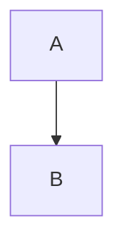

# 图级视觉资产升级生命周期

本参考把已验证的整页图识别、图区域裁切、黑白扫描图增强、可选 Mermaid 重建、Manifest
登记和 Markdown 回填经验接入现有 `document-to-markdown-assets`。它是 Workflow A 的可选图级
工作包，不是新 Workflow，不改变 native-first PDF 路由，也不建立第二套 Manifest 或读者资产目录。

## 1. 适用边界

- OCR、正文清理和图片升级是三条可独立执行的处理线；图片升级不得触发整书 OCR 或正文重做。
- 原生文本 PDF 继续先走 native/no-model 路线。只有扫描图、复杂视觉资产或读者图片需要时，才启用本生命周期。
- Marker、Surya OCR、固定 8/40 页分块和 GPT 清理仅可作为历史案例或显式配置，不得成为 Workflow A 新默认。
- 每批只处理同一个 page-unit、segment 或其他已登记 `content_unit_id` 中的 1–2 张图；闭环通过后才扩大。

## 2. 单一生命周期

```text
figure demand inventory
  → source page resolution
  → figure region localization
  → crop proposal/review/accepted crop
  → enhanced-raster（可选）
  → Mermaid derived representation + validation（可选）
  → 同一个 manifest.yaml + reader asset selection/projection
  → 当前最小 content unit 的 Markdown 回填 + link check
  → 确定性派生 document-temp.md/index.md
  → batch validation and close
```

这条单图/小批链外侧还有一个文档级覆盖循环：从原始或来源最小单元、清理后的 page-unit/segment、
派生 `document-temp.md`/`index.md`/final、现有资产和同一 Manifest 提取需求并取并集。每批 F8 只
回写覆盖台账；`batch_status=passed` 不能推导 `document_status=passed`。

`page-render`、`crop` 和 `enhanced-raster` 都是同一 `manifest.yaml` 中的资产记录。Mermaid 是
`visual-reconstruction-profile` 中的可选派生表达；它不是来源图，也不能取代 PNG fallback。

来源案例中的 `pages/`、`crops/`、`enhanced/`、`derived/`、`manifests/` 用于说明处理阶段。
正式 Workflow A 工程包和读者包继续使用扁平 `assets/`；阶段差异由 `asset_kind`、`derivation`、
profile、evidence 和 Markdown binding 表达。

### 2.1 可执行任务树

下面的缩进是实际依赖，不是新的 Workflow。方括号说明当前执行绑定，避免把契约写成已有自动代码。

```text
F0 图片需求盘点 [procedure-only；尚无专用 figure inventory adapter]
├─ 分别扫描原始/来源单元、当前 page-unit/segment 和派生 Markdown 的图号、图注与链接
├─ 与现有资产和同一 Manifest 对账并更新文档级 figure coverage ledger
├─ 标出 upgraded、legacy-only、missing、reference-missing、needs-review 和 not-applicable
├─ cleaned/final 缺失但来源存在的图号不得从 expected 集合删除
└─ 锁定同一内容单元的 1–2 张图

F1 来源页解析 [page rendering/Manifest 基础登记有代码；legacy 复制需人工确认]
├─ 复用可追溯且哈希匹配的 page-render
├─ legacy 页图复制必须证明 byte-identical 或记录确定性转换来源
├─ 页定位不确定时只探查候选页，并保存页序、页面哈希、contact sheet 和选择结论
├─ 来源缺失时只定点渲染对应页，不扩大为整书渲染
├─ 记录 PDF 页、可选印刷页、content_unit_id 和 source occurrence
└─ 保留来源页，不由后续派生图覆盖

F2 图区域定位 [complex-region-detection Skill；无专用仓库 adapter]
├─ 用图号、图注、正文、对象/bbox 和可见结构建立锚点
├─ 同页多图复用 page parent，但分配不同 figure/region/occurrence ID 与 ordinal
├─ 列出必须保留元素
├─ 列出允许排除元素
└─ 生成带依据、置信度和诊断的保守候选区域

F3 crop 决策与接受 [有相邻 reader-only crop/relink 代码；未兼容/编排到本生命周期；必须人工视觉门]
├─ 生成候选 crop preview
├─ 优先调 y/height，最后才谨慎调 x/width
├─ 与来源页或 overlay 对照
├─ 逐边检查 top/right/bottom/left
│  ├─ clear：无内容被截断
│  ├─ intentional-contact：前景触边但有明确证据与说明
│  ├─ clipped：裁残，返回调整
│  └─ unknown：无法判断，needs-review
├─ 保存 candidate/accepted geometry、坐标空间、安全边距和调整历史
└─ 四边通过后才产生 available crop

F4 可选增强 [procedure-only；无专用 enhancement entrypoint]
├─ 从 accepted crop 派生新文件
├─ 保存工具、版本和实际参数
├─ 并排比较 crop/enhanced 的可读性与结构
└─ 变差或结构风险时回退 crop

F5 可选 Mermaid [profile 契约和人工过程；无 Workflow A generator/render validator]
├─ 判断图形是否属于明确节点—边结构
├─ 必要时产生 evidence-only 放大图/节点子图/OCR probe，不把候选识别当真值
├─ 节点、标签、边、方向和层级逐项绑定来源证据
├─ 运行语法解析
├─ 实际渲染并保存证据
├─ 将渲染结果与来源语义逐项对照
└─ 验证同一 Manifest 中的 PNG fallback

F6 同一 Manifest 与读者资产投影 [基础 Manifest/collection projection 有代码；派生更新未编排]
├─ 历史逐图 Manifest 只以路径/哈希证据导入，并把 success 归一化为 needs-review 后重验
├─ 登记 page-render/crop/enhanced/derived 的稳定 ID、哈希和父子关系
├─ 选择 primary raster、PNG fallback 和 evidence-only 来源页
├─ 只把读者实际使用的资产投影到扁平 assets/
└─ 不创建第二套 Manifest 或 pages/crops/enhanced/derived 读者目录

F7 最小内容单元回填与派生再生成 [回填依 producer；merge/projection 有代码]
├─ 记录回填前 SHA-256
├─ 只修改当前 page-unit/segment/content unit
├─ 重读 Mermaid → PNG fallback → 图题顺序和每条相对链接
├─ 记录回填后 SHA-256 与 asset/representation ID
├─ 对比来源需求与当前 Markdown；引用丢失时定位清理、投影、写出或合并阶段
├─ 确定性合并逐字保留 Mermaid/fallback
└─ 由下游读者投影生成根 index.md 的 assets/... 链接

F8 批次验收与闭合 [独立 validator 有代码；视觉判断仍需人工]
├─ 重读完整来源和派生链
├─ 同步 stage/progress evidence
├─ 分别给出 batch_status 与 document_status
├─ 回写 expected figure IDs 的逐图分类和未闭合清单
└─ 当前 1–2 张图闭合后才解锁下一批
```

机器可读的同一任务树位于
`workflows/document-to-markdown-assets/workflow.yaml` 的
`execution_policy.asset_extraction.figure_asset_lifecycle.task_tree`。每个父任务都明确保存 children、
Skill/Tool、代码路径、当前实现状态、证据和门禁。

### 2.2 实现真实性边界

- `adapters/workflow_a_source_runner.py` 能保存 page-render、基础 Manifest 和来源哈希，但当前普通执行会把
  `evidence/regions.json` 写为 `not-run`，不会自动完成 F2–F5。
- `complex-region-detection` 已存在，正好负责产生 `region-cropping` 所需的候选区域；生命周期不得再
  从 source page 直接跳到裸 crop geometry。
- `skills/region-cropping/scripts/apply_reader_asset_crops.py` 是相邻的 reader-only 哈希锁裁切、重链接和
  页面图删除工具。它不生成 F2 区域定位记录、F3 crop decision 或单一 Manifest 派生更新，并会在
  重链接后删除可再生 reader page image；因此不能作为本工程生命周期的完成证据。只有补齐来源页或
  等价来源证据保留、同一 Manifest 更新和四边复核后，才能讨论接入 Workflow A。
- enhanced-raster 与 Mermaid 目前没有 Workflow A 专用生成/渲染入口。契约和人工过程可用，但真实执行
  未接线时必须如实写 procedure-only/not-run/needs-review。
- `adapters/page_markdown_units.py` 负责逐字合并，不负责自动插入图；
  `adapters/markdown_collection_merge.py` 负责读者资产复制、哈希冲突检查和 `assets/...` 路径投影。
- `tests/validate_real_output_root.py` 会在 Manifest 提供 `figure_coverage` 时重读覆盖集合和
  batch/document 状态；它不会替代 F0 的需求提取器，也不会把缺失该可选证据伪装成已执行。

### 2.3 文档级覆盖台账

`figure_coverage` 是同一个 Manifest 中的对账对象，必要时可把完整明细另存为
`evidence/figure-coverage.json`；它不是资产身份库，也不是第二个 Manifest。最低内容为：

- `demand_sources`：原始/来源单元、cleaned/page-unit、派生 Markdown、现有资产和 Manifest。
- `expected_figure_ids`：上述来源并集，不能只采用当前 cleaned Markdown。
- 每个图号的 content units、需求证据、来源页状态、资产状态、Markdown 状态、生命周期状态和批次。
- 独立的 `batch_status`、`document_status` 和分类计数。

文档 `passed` 必须满足：所有 expected figure ID 恰好有一条记录；无 `missing`、
`reference-missing` 或 `needs-review`；每条 lifecycle status 为 `passed` 或有证据的
`not-applicable`。单批 1–2 张图 passed 只允许解锁下一批。

### 2.4 定点探查与诊断证据

文字层找不到图号或页码不确定时，先在最小候选页范围生成 page render 和 contact sheet。探查记录
必须保存触发原因、候选页、明确页序、页面图/拼图 SHA-256、发现、选择页和状态。contact sheet
不是来源页替代品，也不进入读者 `assets/`。

contact sheet 和缩略 page preview 只用于找页，不是 crop 坐标权威。若在预览图标注候选框，必须
保存 preview/full-resolution 尺寸、scale/rotation transform，并回到有哈希的全分辨率 parent
重新定位 candidate geometry、生成 crop preview 和复核四边。

放大图、节点子图、OCR probe、crop overlay 和前后比较图同样只作 engineering evidence。它们
必须登记稳定诊断 ID、父资产、目的、路径、哈希和保留状态；OCR/视觉输出只提供候选，不能用来
猜节点、箭头、方向、层级或文字。诊断子裁切还要登记方法、参数和相对父资产的坐标变换。未决时
保留，只有引用和哈希锁定的清理流程才允许裁减诊断文件。

### 2.5 同页多图和历史记录迁移

- 同一页可以产生多个 figure。它们共用一个 page-render parent，但各自拥有稳定 `figure_id`、
  `region_id`、`source_occurrence_id`、ordinal、candidate geometry 和 crop decision。
- legacy 文件复制到工程 page-render 时，保存两端哈希和 `source_equivalence`；字节不同时必须记录
  渲染/转换工具及参数，不能只写“已复制”。
- 历史逐图 JSON/YAML 保留原路径和 SHA-256，作为 `historical_manifest_migration` evidence-only。
  资产身份和父子关系合并进当前唯一 `manifest.yaml`，不在目标包继续维护第二套逐图 Manifest。
- 历史 `success` 只代表当时执行或落盘；未重新通过当前来源、crop、增强/Mermaid、回填和 validator
  门禁时，迁入状态必须为 `needs-review`。

## 3. 来源页与图区域判断

先确认现有图片是整页图还是图区域：

- 与同批页面图宽高一致时，优先视为整页导出候选。
- 包含页眉、页码、章节标题、正文段落或页边装饰时，通常仍是整页图。
- 判断结果必须回指可打开的来源页图、页码、来源文件和 SHA-256；不能只保留裁切图或派生图。
- 证据不足时保留整页图并标记 `needs-review`，不得猜测区域边界。

判断为整页图之后，必须先进入 F2 的候选区域定位。现有 `region-cropping` 只能消费带来源依据的候选，
不得把操作员临时输入的裸 `WxH+X+Y` 当成已完成定位。

## 4. 裁切规则

裁切采用“先锁横向，后调纵向”：

1. 先给出保守大框，确保节点、箭头、标签、括号、流程线和必要上下文完整。
2. 优先调整 `y` 与 `height`，去掉页眉、正文残片和已在 Markdown 独立保存的图注。
3. 左右边界默认保持保守；只有确认两侧为纯空白时才收窄。
4. 两侧可能存在竖向箭头、边注、括号或流程线时宁可多留白。

Manifest 必须记录父资产、`WxH+X+Y` geometry、横纵向策略、裁切方法、输出尺寸、SHA-256、
状态和诊断。越界、空裁切、父资产缺失或疑似裁残时不得 `available`。

此外还必须保存 `crop_decision`：候选与接受 geometry、来源像素坐标空间、必须保留/允许排除元素、
四边状态、安全边距、来源/crop/overlay 复核证据和调整历史。坐标不越界只能证明命令可执行，不能
证明区域正确。

## 5. 可读性增强

黑白扫描图可以按当前工具可用性使用以下已验证组合：

```text
-colorspace Gray
-auto-level
-brightness-contrast 5x18 或 5x20
-sharpen 0x1.2 至 0x1.4
```

这些参数是可配置经验，不是新依赖或所有图片的默认命令。每次增强必须记录实际工具、版本和
参数，并满足：

- 只提高对比度、灰阶和边缘可读性，不增加、删除或移动节点、箭头、层级、标签和文字。
- `structure_preserved=true` 才能标为完整。
- 增强效果变差或可能改变结构时，状态为 `needs-review`，Markdown 回退到原 crop。
- crop 与 enhanced-raster 都保留各自 SHA-256，不覆盖同一路径。

## 6. Mermaid 门禁

Mermaid 只用于结构清晰的流程图、推理链、层级图、时间线或明确节点—边关系图。

只有同时满足以下条件才可 `available` 并回填：

- 所有使用的节点、标签、边、方向和层级都有当前来源图、区域或文字 span 证据。
- 邻近正文只在保存精确 source span 且不与图片冲突时用于可见标签的拼写/消歧；不得据正文创建
  图片中未确认的节点、边、方向或层级。冲突进入 `text_corroboration.conflicts` 和 `needs-review`。
- OCR/可见文字足以确认，未使用猜测补全。
- 影响结构的 `uncertainty` 为空。
- `.mmd`/profile 路径、Markdown target 和 PNG `fallback_asset_id` 均可解析。
- Mermaid 语法解析、实际渲染、来源语义逐项对照和 fallback 链接检查全部通过。

扫描噪声重、文字不可靠、结构依赖复杂排版隐喻或任何关系未裁决时，不强行重建；保留 crop/
enhanced PNG，并在工程层写 `Unknown`/`needs-review`。

## 7. Manifest 最低闭合信息

优先复用现有字段：

- `asset_id` 作为稳定资产 ID，`figure_id` 只作为可选外部图号。
- `source_occurrences` 保存来源文件、PDF 页码、可选印刷页码、区域、父资产和 `content_unit_id`。
- `media` 保存 MIME、宽高和 SHA-256。
- `derivation` 保存父资产、操作、geometry/增强参数、结构保真、fallback 和状态。
- `reconstruction_profile.derived_representations` 保存 Mermaid 路径、状态、置信度、来源资产和 PNG fallback。
- `markdown_bindings` 保存 page-unit/segment 路径、读者相对路径、角色和写入状态。
- `status`、`confidence`、`review_notes` 保存失败、不确定项和人工判断。

缺少 Markdown 引用不能成为删除来源图的依据。必须先检查 A5 投影、page-unit 写出、确定性合并
和读者导出环节；来源资产及其 Manifest 记录保持不变。

## 8. Markdown 回填

主编辑面是当前 page-unit、segment 或其他已登记最小内容单元。Mermaid 可靠时：

````markdown



图示标题
````

Mermaid 不可靠时只写：

```markdown


图示标题
```

page-unit/segment 使用其所在层级可解析的 `../assets/...`；page-unit 合并逐字保留链接，不负责改写路径；
根 `index.md` 的下游读者投影使用 `assets/...`。`document-temp.md`、`index.md` 或整书 final 只能由
最小内容单元确定性生成，不作为长期手工编辑面。

## 9. 完成门

一张图只有在以下项目全部闭合后才完成：

- 来源页图或等价来源证据存在且哈希匹配。
- crop 的父资产、geometry 和边界复核通过。
- 候选区域的定位依据、必须保留/允许排除元素、crop decision、四边状态和复核证据可重读。
- 若生成 enhanced-raster，参数、结构保真和 crop fallback 可重读。
- 若生成 Mermaid，节点/边证据、状态、置信度、语法/渲染/语义验证和 PNG fallback 可重读。
- 同一个 Manifest 已更新，没有第二套资产身份。
- 当前最小内容单元已回填，前后哈希、插入资产 ID、派生 Markdown 链接和确定性合并证据可解析。
- 状态为 `passed`，或如实保留 `needs-review`/失败边界。

文档级完成还必须满足覆盖台账门：原始/来源、当前最小单元、派生 Markdown、资产和单一 Manifest
已经对账；所有 expected figure ID 都有闭合记录；不存在 missing/reference-missing/needs-review。
批次 passed 不得代替这一门。

任一项未通过，不扩大到下一批，也不以真实整书转换代替契约和定向测试。
