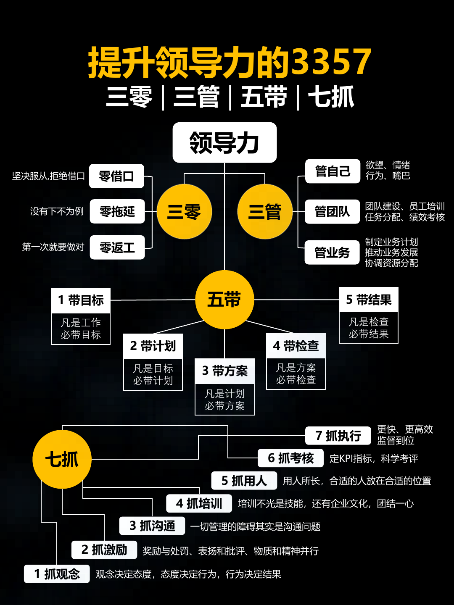
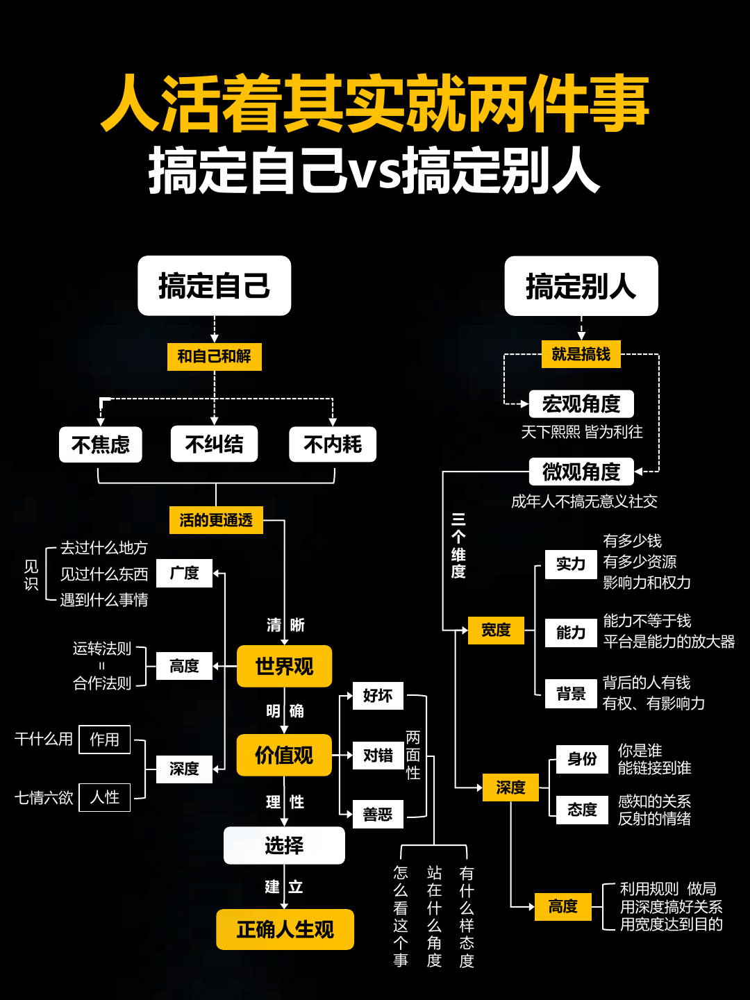

# 18个工作思维模型（测试夹具）

> 来源：`18个工作思维模型-第24-25页.pptx` 与对应 PDF 夹具。
> 本文件是测试夹具的预期 Markdown 结果样例，不代表完整 25 页原文档已经转换完成。

## 第 24 页：提升领导力的 3357

### 总结构

- 领导力由四组结构组成：三零、三管、五带、七抓。
- 三零：零借口、零拖延、零返工。
- 三管：管自己、管团队、管业务。
- 五带：带目标 → 带计划 → 带方案 → 带检查 → 带结果。
- 七抓：抓观念、抓激励、抓沟通、抓培训、抓用人、抓考核、抓执行。

### 关键关系

- 五带是一条递进链：目标产生计划，计划产生方案，方案需要检查，检查形成结果。
- 七抓是一组管理执行维度，包含观念、激励、沟通、培训、用人、考核和执行。
- 页面中的连线、节点位置和层级关系属于视觉证据，不能只用扁平文字替代。

### 【需要保留的】原始视觉资产

> A6 file_name: `work-models__p024__page-render__leadership-3357__original-page__o01.png`

### 待核对与未知形式

- 开放集合未知形式扫描：needs-review；夹具只证明预设关系和资产存在，不证明所有颜色、符号、跨区关系均已分类。

## 第 25 页：搞定自己 vs 搞定别人

### 总结构

- 人活着其实就两件事：搞定自己、搞定别人。
- 搞定自己：和自己和解 → 不焦虑、不纠结、不内耗 → 活得更通透。
- 搞定别人：就是搞钱，并从宏观角度、微观角度和多个能力维度理解关系。

### 搞定自己侧

- 世界观：涉及见识的广度、高度和深度。
- 价值观：涉及好坏、对错、善恶以及选择。
- 正确人生观：由世界观、价值观和选择关系建立。

### 搞定别人侧

- 实力：钱、资源、影响力和权力。
- 能力：能力不等于钱，平台可以放大能力。
- 背景：背后的人可能有钱、有权或有影响力。
- 页面中的左右对比、三维度关系和连接方向需要通过原始页面图保留。

### 【需要保留的】原始视觉资产

> A6 file_name: `work-models__p025__page-render__self-vs-others__original-page__o01.png`

### 待核对与未知形式

- 开放集合未知形式扫描：needs-review；夹具只证明预设关系和资产存在，不证明所有颜色、符号、跨区关系均已分类。

## 未决项

- PDF 文本顺序和 PPTX XML 顺序存在差异时，以原生结构和页面视觉证据共同复核。
- 无法仅靠原生结构确认的布局关系标记为 `needs-review`。
